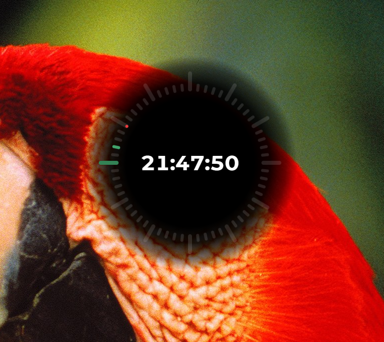
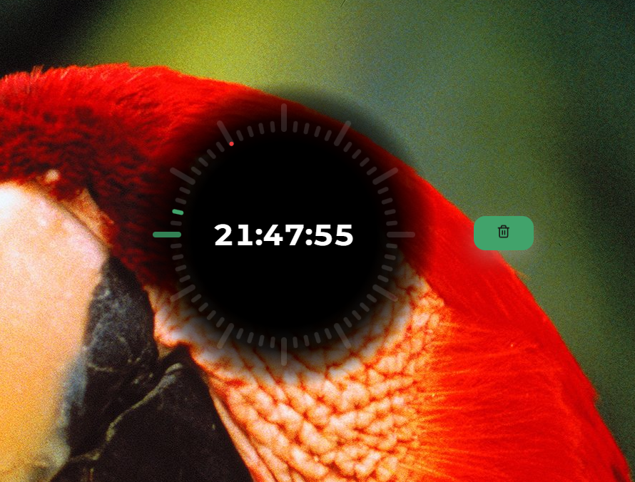

# rustclock

A desktop clock built with Tauri 2, React 19, TypeScript, and Vite. It combines a digital time display with circular hour, minute, and second indicators in a transparent, frameless window.

## Screenshots

<p align="center">
  
  
</p>

## Features

- Local time in `HH:mm:ss` format, updated every second.
- A 12-hour ring and 60-position minute and second rings, with green hour/minute indicators and a red second indicator.
- Bold white numbers in Montserrat Alternates.
- A fixed-size clock that remains centered as the window is resized.
- A centered clock at rest. On hover, the clock slides left and a close button emerges to its right; both return when the pointer leaves.
- Reduced-motion support for the animations.
- Drag the window from the clock or surrounding non-interactive area.
- A system tray icon configured from `src-tauri/icons/icon.ico`.

## Development

Install Node.js compatible with the Vite version in `package.json`, pnpm, and a Rust toolchain with Cargo and Rust 2024 edition support. You also need the native Tauri build prerequisites for your operating system; on Windows, these include the MSVC C++ build tools and WebView2 runtime.

From the repository root:

```sh
pnpm install
pnpm tauri dev
```

Tauri starts the Vite server at `http://localhost:1420` and opens the desktop window. The initial configured window size is 800 × 600.

For frontend-only development:

```sh
pnpm dev
```

Open `http://localhost:1420` in a browser to preview the clock. Native window dragging and closing require the Tauri desktop runtime.

## Build and checks

| Command | Purpose |
| --- | --- |
| `pnpm build` | Check TypeScript and build the frontend into `dist/`. |
| `pnpm preview` | Serve the built frontend locally. |
| `pnpm tauri build` | Build the desktop executable and platform bundles. |
| `pnpm test` | Run component tests in watch mode. |
| `pnpm test:run` | Run the full frontend test suite once. |
| `cargo check --manifest-path src-tauri/Cargo.toml` | Check the Rust backend. |

With Cargo's default target directory, desktop bundles are written under `src-tauri/target/release/bundle/`. Tauri runs `pnpm build` automatically before packaging.

Use pnpm for frontend dependencies and commit changes to `pnpm-lock.yaml`. It is the only frontend lockfile; the Rust dependencies remain locked separately in `src-tauri/Cargo.lock`. For a reproducible installation, run `pnpm install --frozen-lockfile`.

## Tests

The frontend uses Vitest, React Testing Library, jest-dom, user-event, and jsdom. Tests live beside the components as `*.spec.tsx`; shared DOM cleanup and matchers are configured in `src/test/setup.ts`.

- Clock tests cover 24-hour formatting, accessible time labels, second-by-second updates, minute/hour/midnight rollovers, 12-hour indicator positions, system clock changes, and timer cleanup, including React StrictMode.
- Close button tests cover its accessible name, button and SVG clicks, Enter/Space activation, and native API failures.
- App integration tests check that clicking the button or icon closes the window without starting window dragging.

The suite currently contains 28 tests across three files. Native window APIs are mocked, so these tests do not open or close real desktop windows. CSS positioning, hover animations, and the tray appearance still require visual verification in the desktop app.

## Project layout and customization

| Location | Contents |
| --- | --- |
| `src/App.tsx` | Window dragging and composition of the clock and close button. |
| `src/App.css` | Centering, fixed shadow size, spacing, and hover transitions. |
| `src/components/clock/` | Time updates, circular indicators, typography, and indicator colors. |
| `src/components/closeButton/` | Close action, SVG icon, and button styles. |
| `src-tauri/src/lib.rs` | Native application startup and plugin registration. |
| `src-tauri/tauri.conf.json` | Window settings, tray icon, build commands, and application bundle icons. |
| `src-tauri/capabilities/` | Shared native permissions in `default.json`; desktop-only window-state and autostart permissions in `desktop.json`. |
| `src-tauri/icons/` | Application and tray icon assets. |
| `public/favicon.ico` | Browser favicon, copied from the application ICO. |

Change the clock radius, marker sizes, active colors, and number styling in the clock component's CSS. The clock size, button spacing, and animation duration are defined in `src/App.css`; keep the stage's `--clock-size` consistent with the clock container dimensions.

The tray uses `app.trayIcon.iconPath` in `src-tauri/tauri.conf.json`, currently `icons/icon.ico`. Replace it with a valid ICO file and restart the desktop build to apply the change. The application bundle also references separate PNG and ICNS assets; replacing the ICO alone does not update those files or the browser favicon in `public/favicon.ico`.

## Current limitations

- Montserrat Alternates is loaded from Google Fonts in `index.html`. Without network access, the clock uses a sans-serif fallback.
- The tray currently has an icon and tooltip only; no tray menu or click actions are implemented. The close button closes the window rather than hiding it to the tray.
- The autostart plugin is registered, but the app does not enable startup at login or provide a toggle for it.
- The window-state plugin persists the window position and size; the clock itself retains its fixed dimensions.
- The fixed layout may overflow windows smaller than the clock and button group.
